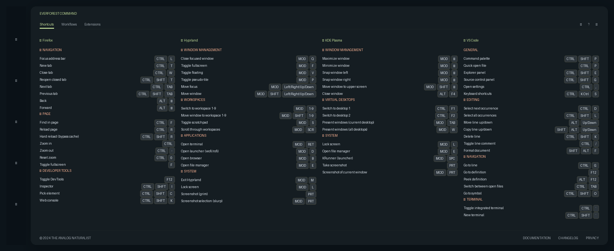

# ShortCheat

Persönliches Keyboard-Shortcut Cheat-Sheet als PNG – generiert aus YAML-Dateien.
Design: **The Analog Naturalist / Everforest** (siehe `DESIGN.md`).



## Struktur

```
examples/           Beispiel-YAML-Dateien (KDE, Hyprland, Firefox, VS Code)
scripts/
  generate_png.py   PNG-Generator (Pillow-basiert, Everforest-Design)
cheat_sheet.png     Generiertes Cheat-Sheet
DESIGN.md           Design-System-Dokumentation
```

Eigene YAML-Dateien liegen unter `~/.config/shortcheat/`.

## YAML-Format

```yaml
app: "Anwendungsname"
description: "Kurzbeschreibung"
sections:
  - name: "Sektionsname"
    shortcuts:
      - keys: "Ctrl + S"
        description: "Speichern"
```

Modifier-Tasten werden automatisch normalisiert:
`Super`/`Meta` → `MOD`, `Ctrl`/`Control` → `CTRL`, `Shift` → `SHFT`, `Alt` → `ALT`, `Return` → `RET`, usw.

## Abhängigkeiten

- Python 3.11+
- **Pillow** ≥ 10.0 (benötigt `rounded_rectangle`, verfügbar ab Pillow 8.2)
- **PyYAML** ≥ 6.0
- Schriftarten: DejaVu Sans / DejaVu Sans Bold / DejaVu Sans Mono (System-Fonts)

```bash
# Installation via uv (empfohlen)
uv sync

# oder klassisch
pip install ".[dev]"
```

## Verwendung

```bash
# YAML-Dateien in Config-Verzeichnis ablegen
mkdir -p ~/.config/shortcheat
cp examples/*.yaml ~/.config/shortcheat/

# PNG generieren
uv run python scripts/generate_png.py
# oder: shortcheat  (nach Installation als Paket)
```

Das Ergebnis wird als `cheat_sheet.png` im aktuellen Verzeichnis gespeichert (1920 px breit, Höhe dynamisch).

## Cheat-Sheet anzeigen

### Hyprland – Hold-to-show via Special Workspace

Das Bild wird **einmalig beim Start geladen** und in einem unsichtbaren
Scratchpad-Workspace versteckt. `SUPER + F1` blendet es sofort ein,
Loslassen blendet es sofort wieder aus – keine Prozessstarts, keine
Race-Conditions.

Füge folgendes in `~/.config/hypr/hyprland.conf` ein:

```hyprlang
# Bild einmalig beim Start laden (läuft unsichtbar im Hintergrund)
exec-once = imv -b 000000 /home/patrick/repos/shortcheat/cheat_sheet.png

# Fensterregeln: Bild in Scratchpad-Workspace verstecken
windowrule {
  match:title  = cheat_sheet.png
  workspace    = special:cheat silent
  float        = on
  center       = on
  border_size  = 0
  no_shadow    = on
  no_anim      = on
  opacity      = 0.85 0.85
}

# Hold-to-show: Einblenden beim Drücken, Ausblenden beim Loslassen
bind  = SUPER, F1, togglespecialworkspace, cheat
bindr = SUPER, F1, togglespecialworkspace, cheat
```

**Ersteinrichtung** (einmalig nach dem Speichern, da `exec-once` erst
beim nächsten Hyprland-Start greift):

```bash
imv -b 000000 /home/patrick/repos/shortcheat/cheat_sheet.png &
```

> **Hinweis nach Hyprland-Reload:** Da `exec-once` nur beim Booten
> ausgeführt wird, imv nach einem `hyprland reload` ggf. manuell neu
> starten, damit sich der Workspace-Zustand zurücksetzt.

### KDE – Globalen Shortcut anlegen

Systemeinstellungen → Shortcuts → Globale Shortcuts, Befehl:

```bash
pqiv -c -i -t --hide-cursor-at-bins /path/to/cheat_sheet.png
```

## Design

Das Skript implementiert das **Everforest / "The Analog Naturalist"**-Design aus `DESIGN.md`:

- Farbpalette: `surface` `#0c141a` → `primary` `#c2dc99` → `secondary` `#ffb595`
- 4-Spalten-Grid mit automatischer Höhenbalancierung
- Key-Chips als gerundete Rechteck-Badges (Modifier normalisiert)
- Kategorie-Icons per Emoji-Mapping
- Glassmorphism-Card-Effekt via `ImageFilter.GaussianBlur`
- Ghost-Borders (15 % Opacity) statt harter Trennlinien
